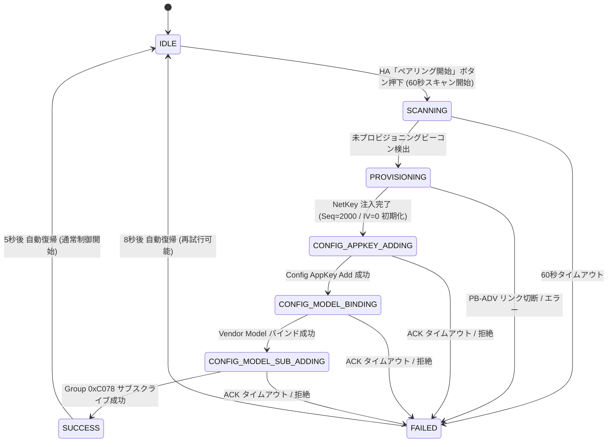

# DAIKO DP-41924 ペアリング運用ガイド

本ドキュメントは、大光電機（DAIKO）製 6回路シーンコントローラー（型番: `DP-41924`）と ESP32（ESPHome）をペアリング（Bluetooth Mesh Provisioning & Model Binding）するための手順と運用仕様をまとめたマニュアルです。

---

## 1. ペアリングの概要

本コンポーネントは Bluetooth Mesh Provisioner および Configuration Client 機能を備えており、未プロビジョニング状態の壁面コントローラー（`DP-41924`）を検出して以下の設定シーケンスを自動実行します：

1. **BLE Mesh Provisioning (PB-ADV)**:
   - 未プロビジョニングビーコンを受信し、コントローラーに Unicast アドレス（既定: `0x0004`）および `secrets.yaml` で定義した Network Key (`NetKey`) を注入します。
2. **AppKey 配布 (`AppKey Add`)**:
   - `secrets.yaml` で定義した Application Key (`AppKey`) をコントローラーに登録します。
3. **ベンダーモデルバインド (`Model App Bind`)**:
   - コントローラーの Vendor Model（Company ID: `0x0AF8`, Model ID: `0x0000`）に AppKey をバインドします。
4. **グループ購読登録 (`Model Sub Add`)**:
   - 一括制御グループアドレス `0xC078` をベンダーモデルに登録します。
5. **シーケンス番号・IV Index の自動初期化**:
   - コントローラー初期化時のリプレイ保護リスト（RPL）リセットに合わせ、ESP32 側のシーケンス番号（SeqNum）を安全初期マージン `2000` に、IV Index を `0` に自動設定し、安定した通信稼働を確保します。

---

## 2. アドレスおよびシーケンス番号（SeqNum）の自動初期化仕様

> [!IMPORTANT]
> **親機（DP-41924）を初期化した際のアドレス・シーケンス不整合を防ぐため、本コンポーネントはペアリング完了時に以下の自動初期化を実行します。**

1. **シーケンス番号（SeqNum）のクリーンリセット**:
   - DP-41924 のペアリング解除（初期化）を行うと、内部の Replay Protection List (RPL) が消去され `0` に戻ります。
   - プロビジョニング完了イベント（`ESP_BLE_MESH_PROVISIONER_PROV_COMPLETE_EVT`）を検知すると、ESP32 側は自動的にシーケンス番号を安全初期マージン **`2000`** にリセットし、NVS（`daiko_seq_num_v1`）へ永続化します。
2. **セルフアドレス（`self_address`）のスロット初期化**:
   - プロビジョニング完了時、セルフアドレスを初期スロット `base_self_addr_ + 1`（`0x0021`）に初期化し、IV Index および周回エポック（`wrap_epoch_`）も `0` からリフレッシュします。
3. **親機アドレス（`controller_address`）の固定割り当て**:
   - ESP-IDF の `esp_ble_mesh_provisioner_prov_device_with_addr()` を使用し、DP-41924 に割り当てる Unicast Address を **`0x0004` に固定** してプロビジョニングします。

---

## 3. ペアリングステートマシン (`PairingState`)

ペアリング処理は非同期ステートマシンとして動作し、Home Assistant のテキストセンサー（`text_sensor.pairing_state`）にリアルタイムで反映されます。



---

## 4. 提供される Home Assistant ペアリングエンティティ

`daiko_scenecontroller_ble:` の `auto_create_entities: true`（既定値）により、以下のエンティティが自動生成されます：

| ドメイン | エンティティ名 | オブジェクトID | 説明 |
| :--- | :--- | :--- | :--- |
| **Button** | `ペアリング開始 (Start Pairing)` | `start_pairing` | 未プロビジョニング機器の探索とペアリングを開始（60秒間有効） |
| **Button** | `ペアリング中止 (Cancel Pairing)` | `cancel_pairing` | ペアリング探索を即座に中断し通常待機モードへ復帰 |
| **Text Sensor** | `DAIKO ペアリング状態 (Pairing State)` | `pairing_state` | 現在のペアリング進捗（`Idle / Standby`, `Scanning...`, `Provisioning...`, `Success` 等）をリアルタイム表示 |

---

## 5. ペアリング実施手順（ステップバイステップ）

### Step 1: 任意の暗号鍵（NetKey / AppKey）の準備
PC のターミナル等で任意の 16 バイト（32 文字）の 16 進ランダムキーを生成します：

```bash
# NetKey 生成例
openssl rand -hex 16

# AppKey 生成例
openssl rand -hex 16
```

生成した文字列を `secrets.yaml` に設定します：

```yaml
daiko_net_key: "0123456789ABCDEF0123456789ABCDEF"
daiko_app_key: "FEDCBA9876543210FEDCBA9876543210"
```

### Step 2: ESPHome ファームウェアの書き込み
ESP32 にファームウェアを書き込み、起動します。

### Step 3: 壁のシーンコントローラー（DP-41924）のペアリング解除（初期化）操作

本体前面のタッチ操作パネルから Bluetooth 設定の削除（初期化）を行います。

1. 本体の **`ON/OFF` ボタン** をタッチして電源を入れます。
2. **`設定` ボタン** を長押し（2秒以上タッチ）します。
   - `設定` ボタン下側がオレンジ色、`ON/OFF` ボタン下側が赤色に点滅し、`デジタル表示部` に `LS` が点滅表示されます。
3. デジタル表示部横の **`矢印ボタン`（`∧` / `∨`）** で Bluetooth 設定メニュー **`「ｂＬ」`**（7セグ表示: `bL`）に切り替え、**`設定` ボタン** をタッチします。
4. **`矢印ボタン`** で削除メニュー **`「ｂＬ：ｄＥ」`**（7セグ表示: `bL:dE`、Delete）に切り替え、**`設定` ボタン** をタッチします。
5. `デジタル表示部` に **`y`** が表示されたら、**`設定` ボタン** をタッチしてペアリング設定を削除します。
   - 削除が完了すると `bL` メニュー内に戻ります。
6. **`矢印ボタン`** で Bluetooth 設定が **`「ｂＬ：ｏｎ」`**（7セグ表示: `bL:on`）になっているか確認します（`bL:oF` の場合は `bL:on` に切り替えて **`設定` ボタン** をタッチします）。
7. **`ON/OFF` ボタン** をタッチして詳細設定を終了します。
8. 本体の **`通信ランプ（青色）`**（青い通信 LED）が **等間隔で点滅** していることを確認します。
   - 青い通信 LED が等間隔で点滅していれば初期化（Bluetooth オン／ペアリング未状態）は完了しており、未プロビジョニングビーコン（PB-ADV）が送出されます。

> [!NOTE]
> **`通信ランプ（青色）` の点灯状態（公式マニュアル表記）**:
> - **点滅（等間隔）**: Bluetooth オン／ペアリング未（本手順による初期化完了・ペアリング待機状態）
> - **点灯**: Bluetooth オン／ペアリング済
> - **消灯**: Bluetooth オフ（`bL:oF` 設定時）
>
> 参考: 大光電機 `DP-41924` 製品詳細・取扱説明書（`O01-41924-1`）
> - 製品詳細ページ: https://src.lighting-daiko.co.jp/products/app/search/item/detail/pid/DP-41924
> - 取扱・施工説明書 PDF: https://src.lighting-daiko.co.jp/products/app/api/file/raw/id/4601760000

### Step 4: Home Assistant からペアリング開始
1. Home Assistant のダッシュボードを開きます。
2. **「ペアリング開始 (Start Pairing)」ボタン** を押します。
3. `DAIKO ペアリング状態 (Pairing State)` が **「Scanning for DP-41924 (PB-ADV)...」** に変化します。

### Step 5: 自動プロビジョニングの完了
ESP32 が未プロビジョニングビーコンを受信すると、自動的に以下のシーケンスが実行されます：
1. **NetKey 注入**: DP-41924 をアドレス `0x0004` としてプロビジョニング
2. **AppKey 配布**: 親機に `app_idx=0` として AppKey を追加
3. **モデルバインド**: DAIKO Vendor Model（`CID: 0x0AF8`, `Model ID: 0x0000`）に AppKey をバインド
4. **グループ登録**: 全体制御グループ `0xC078` をベンダーモデルにサブスクライブ登録
5. **状態確定**: シーケンス番号を `2000`、IV Index を `0` に初期化し、即座に通常運用へ移行

ペアリング完了後、自動的に各回路のハードウェア種別（`CtrlInfo` `51 01`）と現在点灯状態（`LevelInfo` `51 02`）が同期され、Home Assistant から照明操作が可能になります。
