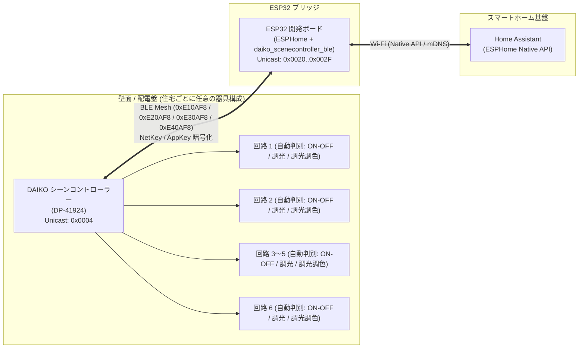

# esphome-daiko-scenecontroller-ble

**DAIKO Scene Controller (DP-41924) Bluetooth Mesh Custom Component for ESPHome & Home Assistant**

[](LICENSE)

大光電機（DAIKO）製 6回路シーンコントローラー（型番: `DP-41924`）を Bluetooth Low Energy (BLE Mesh) 経由でローカル制御し、Home Assistant へ統合するための ESPHome 外部コンポーネント（`daiko_scenecontroller_ble`）です。

クラウドサービスや専用ゲートウェイを介さず、ESP32 開発ボード単体で完全ローカルかつ低遅延な双方向制御・状態同期を実現します。

---

## 重要なお知らせ・免責事項

### プロジェクトの位置づけとメンテナンス方針
- 本リポジトリは、個人のスマートホーム環境において `DP-41924` を Home Assistant から操作・自動化するために開発された相互運用コンポーネントを公開しているものです。
- ソースコードおよびドキュメントの構築には AI コーディングエージェントとのペアプログラミングを活用しています。
- 商用製品のようなサポートや、あらゆる機器構成・ファームウェア版での動作保証はいたしかねます。不具合報告（Issue）や改善の Pull Request は歓迎します。

### 免責事項 (Disclaimer)
- 本プロジェクトは大光電機株式会社（DAIKO）とは一切関係のない、**非公式（Unofficial）の独立したオープンソースプロジェクト**です。
- 本ソフトウェアおよびドキュメントの使用によって生じたいかなる損害（機器の故障、誤動作、事故、その他一切の不利益）について、作者およびコントリビューターは一切の責任を負いません。すべて自己責任（At your own risk）にてご利用ください。
- 商標およびサードパーティライセンスに関する詳細は [THIRD_PARTY_NOTICES.md](THIRD_PARTY_NOTICES.md) を参照してください。

---

## 主な機能

- **完全ローカル制御 (Local Push / Polling)**:
  - 外部クラウド不要。宅内の BLE Mesh ネットワーク上で ESP32 と `DP-41924` が直接通信します。
- **ゼロコンフィグ自動エンティティ公開 (`auto_create_entities: true`)**:
  - YAML に個別の `light:` や `button:` を1つずつ記述しなくても、`daiko_scenecontroller_ble:` ハブを定義するだけで、主電源ライト、回路 1〜6 ライト、シーン 1〜6 呼び出しボタン、全点灯/全消灯ボタン、ペアリング開始/中止ボタン、保守ボタン、および診断センサー（計 27 エンティティ）が自動的に Home Assistant へ公開されます。
- **回路種別の自動判別と統一 `light` エンティティ公開 (`type: auto`)**:
  - 住宅・施主ごとに回路 1〜6 のどれにどの種類の照明器具（電気的結線・制御方式）が接続されているかは異なります。`DP-41924` 本体には施工説明書に基づき **L1〜L6 の 6 種類の負荷設定** があり、機能としては「**調光調色**」「**単色調光**」「**ON/OFFのみ**」の 3 種類に分類されます。
  - 本コンポーネントは `DP-41924` から取得する `CtrlInfo`（`51 01` の 9〜14 バイト目）から各回路の負荷設定（`L1`〜`L6`）を自動判別し、NVS（`daiko_ctype_v1`）に永続化した上で最適な `light` エンティティとして公開します：
    - **調光調色照明 (`L5`: `0x05` PWM調色調光 / `L6`: `0x06` 信号線不要調色調光)**: `ColorMode::COLOR_TEMPERATURE`（明るさ `0`〜`100%`、色温度 `2700K`〜`5000K` / `200`〜`370` mireds）
    - **単色調光照明 (`L1`: `0x01` LED逆位相調光 / `L2`: `0x02` 白熱灯逆位相調光 / `L4`: `0x04` PWM調光)**: `ColorMode::BRIGHTNESS`（明るさ `0`〜`100%`）
    - **ON/OFF 照明 (`L3`: `0x03` ON/OFF 非調光タイプ)**: `ColorMode::ON_OFF`（調光・調色なしの ON/OFF ライトエンティティ）
    - **主電源 (`master`)**: `ColorMode::ON_OFF`（各回路の調光設定値を保持したまま全体出力を ON/OFF するマスターライトエンティティ）
    - ※`L1` (`0x01`)、`L3` (`0x03`)、`L6` (`0x06`) は実機にて動作検証済みです。`L2` (`0x02`)、`L4` (`0x04`)、`L5` (`0x05`) は照明器具への電気的な出力・結線方式（白熱灯調光カーブや PWM 信号線の有無）のバリエーションであり、BLE Mesh 上のチャンネル制御仕様は共通であるためコード実装上そのまま対応しています（実機未検証）。
- **シーンコントローラー連携**:
  - 本体に登録されているシーン 1〜6 を Home Assistant からワンタップで呼び出し可能。
  - `CtrlInfo`（`51 01`）から取得した各シーンのプリセット構成をキャッシュし、シーン切替時に消灯回路の遮断ビット（`0x80`）が残る本体挙動を自動的に先行解除して確実に復帰させます。
- **主電源 OFF からの単独排他点灯 (`Exclusive ON`)**:
  - 主電源 OFF 状態から特定の 1 回路のみを ON にした場合、他回路を消灯状態に保ったまま対象回路のみを単独点灯させる排他制御を実装しています。
- **330ms レート制限・差分送信・スナップバック防止ガード**:
  - スライダー操作開始時は即時送信し、連続ドラッグ中は 330ms 周期でスロットリング、操作完了時に最終値を確定送信します。
  - ハードウェアのフェード遷移中に古いポーリング応答で Home Assistant 側の UI スライダーが跳ね戻る現象を防止します。
- **BLE Mesh IV Index 自動追従 & シーケンス番号 (SeqNum) 永続化・自己復旧**:
  - シーケンス番号および IV Index 状態を NVS に永続化し、再起動時のリプレイ保護（RPL）拒絶や暗号化 Nonce 不一致を防止します。
  - `CONFIG_BLE_MESH_IVU_RECOVERY_IVI` による正規 IV Index 更新（`0 -> 1 ...`）への追従、自己ループバックエコー除外、および上限到達時・通信途絶時のセルフアドレス自動巡回（`0x0020`〜`0x002F` の 16 スロット、連続自動ローテーション上限保護付き）を備えています。

---

## システム構成



---

## 動作要件

1. **ハードウェア**:
   - 大光電機（DAIKO）6回路シーンコントローラー `DP-41924`
   - ESP32 開発ボード（`esp32dev` / ESP32-WROOM-32 等、ESP-IDF フレームワークおよび BLE Mesh 対応チップ）
2. **ソフトウェア**:
   - ESPHome `2025.5.0` / `2026.2.0` 以降推奨（ESP-IDF フレームワークを使用）
   - Home Assistant
3. **ネットワーク鍵 (`NetKey` / `AppKey`)**:
   - 任意のランダムな 16 バイト（32 文字の 16 進文字列）の NetKey / AppKey を指定可能です。ESP32 自身が Provisioner となり、壁面コントローラーへ安全に注入・設定します。
   - ペアリングおよび初期化手順は [PAIRING_GUIDE.md](PAIRING_GUIDE.md) を参照してください。

---

## クイックスタート

### 1. Home Assistant / ESPHome での設定（自動エンティティ公開）

ご自身の ESPHome YAML 設定ファイルに `external_components` と `daiko_scenecontroller_ble` ハブを指定するだけで、全回路のライト・シーンボタン・診断センサーが自動生成されます（完全な設定例は [daiko_controller.yaml](daiko_controller.yaml) を参照してください）：

```yaml
external_components:
  - source:
      type: git
      url: https://github.com/RanasGenoa/esphome-daiko-scenecontroller-ble.git
      ref: main
    components: [daiko_scenecontroller_ble]

daiko_scenecontroller_ble:
  id: daiko_hub
  net_key: !secret daiko_net_key
  app_key: !secret daiko_app_key
  controller_address: 0x0004
  group_address: 0xC078
  self_address: 0x0020
  update_interval: 5s
  auto_recovery_timeout: 90s
  auto_create_entities: true
```

### 2. `secrets.yaml` の準備

[`secrets.yaml.example`](secrets.yaml.example) を `secrets.yaml` にコピーし、Wi-Fi 認証情報、API 暗号化キー、および任意の 16 バイト Hex キー（`openssl rand -hex 16` 等で生成）を設定します：

```bash
cp secrets.yaml.example secrets.yaml
```

```yaml
wifi_ssid: "YOUR_WIFI_SSID"
wifi_password: "YOUR_WIFI_PASSWORD"
wifi_hotspot_password: "YOUR_HOTSPOT_PASSWORD"
api_encryption_key: "YOUR_ESPHOME_API_KEY"
ota_password: "YOUR_OTA_PASSWORD"

# openssl rand -hex 16 などで生成した任意の16バイト鍵
daiko_net_key: "0123456789ABCDEF0123456789ABCDEF"
daiko_app_key: "FEDCBA9876543210FEDCBA9876543210"
```

### 3. ビルドと書き込み

```bash
# 設定ファイルの構文・スキーマ検証
esphome config daiko_controller.yaml

# ファームウェアのコンパイルと実機への書き込み
esphome run daiko_controller.yaml --device /dev/cu.usbserial-XXXX
```

### 4. ペアリングの実行

1. 壁面の `DP-41924` を初期化モード（リセット）にします（手順は [PAIRING_GUIDE.md](PAIRING_GUIDE.md) を参照）。
2. Home Assistant のエンティティ一覧から `button.daiko_start_pairing`（ペアリング開始）を押下します。
3. ESP32 が自動的に未プロビジョニングビーコンを検出し、プロビジョニング、AppKey 登録、モデルバインド、グループ購読設定を完了させます。
4. ペアリング完了後、`DP-41924` から `CtrlInfo`（`51 01`）を取得して回路種別（ON/OFF・調光・調光調色）を自動検出し、最適な Home Assistant ライト属性（`ON_OFF` / `BRIGHTNESS` / `COLOR_TEMPERATURE`）を反映します。

---

## 設定パラメータリファレンス

### ハブ設定 (`daiko_scenecontroller_ble`)

| パラメータ | 必須 | デフォルト値 | 説明 |
| :--- | :--- | :--- | :--- |
| `net_key` | 必須 | - | 32文字（16バイト）の16進 BLE Mesh Network Key |
| `app_key` | 必須 | - | 32文字（16バイト）の16進 BLE Mesh Application Key |
| `controller_address` | 任意 | `0x0004` | `DP-41924` 親機の Unicast アドレス |
| `group_address` | 任意 | `0xC078` | シーン一括制御・主電源制御用の Group アドレス |
| `self_address` | 任意 | `0x0020` | ESP32 ローカル Provisioner のベース Unicast アドレス（`base..base+15` の16スロットを使用） |
| `update_interval` | 任意 | `5s` | 親機状態（`LevelInfo` / `CtrlInfo`）のポーリング周期 |
| `auto_recovery_timeout` | 任意 | `90s` | 親機無応答時にセルフアドレス自動ローテーションを発動するまでのタイムアウト（`0s` で無効化） |
| `auto_create_entities` | 任意 | `true` | 主電源ライト、回路1〜6ライト（自動判別）、シーン1〜6・制御・保守ボタン、診断センサーを自動生成して Home Assistant へ公開 |

### 自動公開される Home Assistant エンティティ一覧 (`auto_create_entities: true` 時)

| ドメイン (`platform`) | `type` | デフォルト名 (`object_id`) | 機能・ハードウェア連動仕様 |
| :--- | :--- | :--- | :--- |
| `light` | `master` | `主電源` (`master_power`) | 各回路の調光設定値を保持したまま全体の出力を ON/OFF するマスターライト (`ColorMode::ON_OFF`) |
| `light` | `auto` | `回路 1`〜`回路 6` (`circuit_1`..`circuit_6`) | `CtrlInfo` (`51 01`) から回路種別を自動判別：<br/>- `0x03`: ON/OFF ライト (`ColorMode::ON_OFF`)<br/>- `0x01` / `0x02`: 調光ライト (`ColorMode::BRIGHTNESS`, `0`〜`100%`)<br/>- `0x06`: 調光調色ライト (`ColorMode::COLOR_TEMPERATURE`, `200`〜`370` mireds) |
| `button` | `scene` | `シーン 1`〜`シーン 6` (`scene_1`..`scene_6`) | 本体の登録シーン（`scene_id: 1..6`）を呼び出し |
| `button` | `all_on` / `all_off` | `全点灯 (All ON)` / `全消灯 (All OFF)` (`all_on` / `all_off`) | 主電源の一括 ON / OFF トリガー |
| `button` | `start_pairing` | `ペアリング開始 (Start Pairing)` (`start_pairing`) | DP-41924 の未プロビジョニングビーコンを探索し、プロビジョニングを実行 |
| `button` | `cancel_pairing` | `ペアリング中止 (Cancel Pairing)` (`cancel_pairing`) | 実行中のペアリング探索・プロビジョニング処理を中断 |
| `button` | `query_status` | `状態更新 (Sync)` (`query_status`) | 壁スイッチ操作後などの状態を即時取得 |
| `button` | `rotate_address` | `アドレス更新 (Rotate Address)` (`rotate_address`) | セルフアドレスを +1 スロット繰り上げ、SeqNum をリセットして再起動 |
| `button` | `reset_sequence` | `シーケンス番号リセット (Reset SeqNum)` (`reset_sequence`) | 現在のアドレスのまま SeqNum を 2000 にリセットして再起動 |
| `text_sensor` | `pairing_state` | `DAIKO ペアリング状態 (Pairing State)` (`pairing_state`) | 現在のプロビジョニング進行状態（`idle` / `scanning` / `provisioning` / `config_*` / `success` / `failed`） |
| `text_sensor` | `self_address` | `DAIKO セルフアドレス (Self Address)` (`self_address`) | 現在使用中の BLE Mesh 送信元 Unicast アドレス（例: `0x0021`） |
| `text_sensor` | `connection_status` | `DAIKO 親機通信ステータス (Status)` (`connection_status`) | 親機との双方向通信状態（`online` / `offline`） |
| `binary_sensor` | `connected` | `DAIKO 親機オンライン (Connected)` (`connected`) | 通信途絶アラート・自動化トリガー用の接続状態二値センサー |
| `sensor` | `sequence_number` | `DAIKO 送信シーケンス番号 (SeqNum)` (`sequence_number`) | 現在の 24bit BLE Mesh シーケンス番号（`bt_mesh.seq`） |
| `sensor` | `missed_responses` | `DAIKO 親機未応答カウント (Missed)` (`missed_responses`) | 連続未応答ポーリング回数（正常時 `0`） |
| `sensor` | `active_scene` | `DAIKO 現在シーン (Scene)` (`active_scene`) | 現在有効なシーン番号（`1`〜`6`） |

> [!TIP]
> YAML 側で一部のエンティティのみを手動定義したい場合は、`daiko_scenecontroller_ble:` に `auto_create_entities: false` を指定した上で、トップレベルの `light:`（`type: auto` / `master` / `on_off` / `dimmable` / `tunable_white`）、`button:`、`sensor:`、`binary_sensor:`、`text_sensor:` に `platform: daiko_scenecontroller_ble` を記述できます。

---

## ドキュメント一覧

- **[PAIRING_GUIDE.md](PAIRING_GUIDE.md)**: ペアリング・初期化手順書（壁面コントローラーのリセットとプロビジョニング）
- **[docs/PROTOCOL_SPEC.md](docs/PROTOCOL_SPEC.md)**: BLE Mesh ベンダープロトコル仕様書（Opcode、サブコマンド、`CtrlInfo` / `LevelInfo` フォーマット）
- **[docs/ARCHITECTURE_AND_BEHAVIOR.md](docs/ARCHITECTURE_AND_BEHAVIOR.md)**: 内部制御モデルと設計アーキテクチャ仕様書
- **[docs/TROUBLESHOOTING_AND_MAINTENANCE_GUIDE.md](docs/TROUBLESHOOTING_AND_MAINTENANCE_GUIDE.md)**: BLE Mesh 通信トラブルシューティングと保守改修ガイド
- **[CONTRIBUTING.md](CONTRIBUTING.md)**: コントリビューション・ブランチ運用・リリースガイドライン
- **[AGENTS.md](AGENTS.md)**: 開発者および AI エージェント向けアーキテクチャ・品質ガードレール規約
- **[THIRD_PARTY_NOTICES.md](THIRD_PARTY_NOTICES.md)**: 商標・サードパーティライセンス表記および法規遵守に関する注意事項

---

## ライセンス

本リポジトリのソースコードは [MIT License](LICENSE) の下で公開されています。
