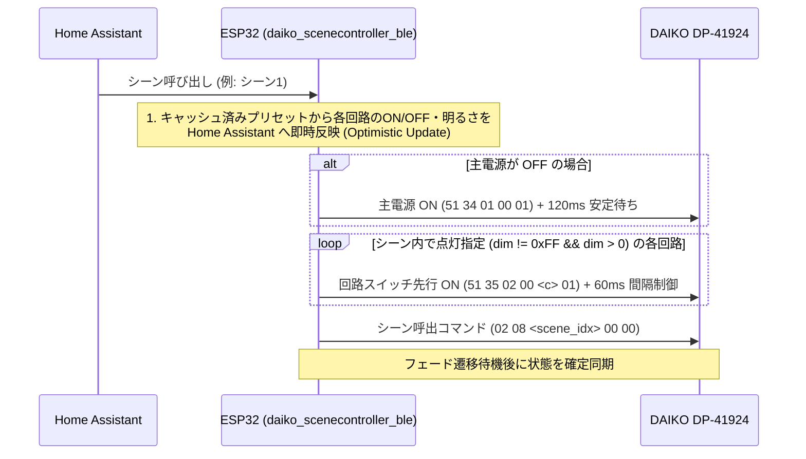
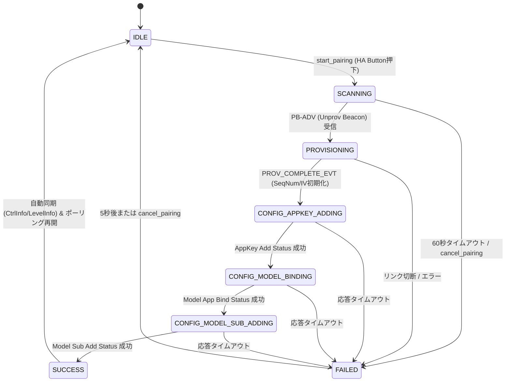

# DAIKO シーンコントローラー 内部挙動と設計アーキテクチャ仕様書

本ドキュメントでは、DAIKO 6回路シーンコントローラー（`DP-41924`）のハードウェア仕様・制御モデル、および本 ESPHome カスタムコンポーネント（`daiko_scenecontroller_ble`）がそれらをどのように統合・最適化して Home Assistant 上で高い安定性と応答性を実現しているかを解説します。

---

## 1. ハードウェアの二重状態モデル（`51 35` 回路開閉 vs `51 51` チャンネルレベル）

`DP-41924` は、各回路 $c \in \{1..6\}$ に対して以下の **2つの独立した状態レイヤー** を持っています。これらは `LevelInfo`（`51 02`）応答の偶数チャンネルバイト `raw_dim` の上位1ビットと下位7ビットに符号化されています。

```text
            LevelInfo (51 02) 偶数バイト: raw_dim
        ┌──────────────────┬─────────────────────────┐
        │   Bit 7 (0x80)   │    Bits 6..0 (0x7F)     │
        ├──────────────────┼─────────────────────────┤
        │ 回路遮断フラグ   │ 保持調光レベル (0..100) │
        │  0 = 通電 (ON)   │  51 51 コマンドで制御   │
        │  1 = 遮断 (OFF)  │  (消灯時も下位7bit保持) │
        │  51 35 で制御    │                         │
        └──────────────────┴─────────────────────────┘
```

1. **回路開閉状態（`relay_on`: サブコマンド `0x51 0x35`）**:
   - `51 35 02 00 <circuit> 00` を送ると、`raw_dim` の最上位ビット（`0x80`）が `1` になり、下位7ビットの調光率を保持したまま回路が遮断（消灯）されます。
   - **ハードウェア固有の制限（ロックアウト現象）**:
     `0x80` ビットがセットされた（`51 35` が OFF の）回路は、後から調光コマンド（`51 51`）やシーン呼出コマンド（`02 08`）を送っても **`0x80` ビットが自動解除されず点灯しない** というファームウェア挙動が存在します。
2. **チャンネル調光・調色レベル（`current_dim` / `colortemp`: サブコマンド `0x51 0x51`）**:
   - 偶数チャンネル $(c-1)\times 2$ が明るさ（`0..100%`）、奇数チャンネル $(c-1)\times 2 + 1$ が色温度（`0..100%`）を制御します。
   - ON/OFF照明種別（`0x03`）の回路においても、`51 51` のレベル `100`（`0x64`）および `0`（`0x00`）と `51 35`（回路開閉）を組み合わせて出力を切り替えられます。

### 1.1 回路種別の自動判別と統一 `light` エンティティ公開 (`auto_create_entities` & `daiko_ctype_v1`)
住宅（施主）ごとに回路 1〜6 にどの種別の照明器具が接続されているかは異なるため、本コンポーネントは以下の自動判別・自動公開アーキテクチャを採用しています：
1. **ゼロコンフィグ自動エンティティ生成 (`auto_create_entities: true`)**:
   - `daiko_scenecontroller_ble:` ハブ設定のみで、主電源ライト（`type: master`）および回路 1〜6 ライト（`type: auto`）、シーン 1〜6 ボタン、制御・保守ボタン、診断センサーを自動生成します。
   - 調光・調色機能を持たない ON/OFF 照明回路（`0x03`）および主電源（`51 34`）も、`switch` ドメインではなくすべて **`light` ドメイン（`ColorMode::ON_OFF`）** として統一公開します。
2. **`CtrlInfo` (`51 01`) によるハードウェア負荷設定（L1〜L6）の自動検出と NVS 永続化 (`daiko_ctype_v1`)**:
   - 親機から受信する `CtrlInfo`（`51 01` のバイト `9..14`）から各回路の `HardwareCircuitType`（`0x01`: L1 LED逆位相調光、`0x02`: L2 白熱灯逆位相調光、`0x03`: L3 ON/OFF、`0x04`: L4 PWM調光、`0x05`: L5 PWM調色調光、`0x06`: L6 信号線不要調色調光）を取得し、3種類の制御モード（`L3` -> `ON_OFF`、`L1`/`L2`/`L4` -> `BRIGHTNESS`、`L5`/`L6` -> `COLOR_TEMPERATURE`）へ自動マッピングします。
   - 初回起動時または親機側での回路設定変更時に NVS（`daiko_ctype_v1`, `PersistedCircuitTypes`, `magic = 0x44435431`）との差分を検知すると、新しい回路種別配列を NVS に保存して自動的に再起動（`esp_restart()`）します。
   - 次回起動時は `LightState::setup()` の初期化段階（`ensure_circuit_types_loaded_()`）で NVS から回路種別を即時復元するため、Home Assistant へ常に正確な `LightTraits`（`ON_OFF` / `BRIGHTNESS` / `COLOR_TEMPERATURE`）を公開できます。

### 本コンポーネントの制御ポリシー
- **消灯操作 (`turn_off_circuit`)**:
   ESP32 メモリ上の `CircuitState::retained_dim` に直前の明るさ（`1..100%`）を記憶した上で、ハードウェアには **`51 51` でレベル `0%` を送信** します（`51 35` は ON のまま維持）。これにより、壁スイッチ本体でシーンボタンを押した際や次回の調光操作時に `0x80` ロックアウトが発生するのを防ぎます。
- **点灯操作 (`turn_on_circuit`)**:
   回路が消灯状態から点灯へ遷移する際、または `relay_on == false`（`0x80` ビットが立っている状態）を検知している場合は、自動的に **`51 35`（回路ON）と `51 51`（目標調光率・色温度）を連動送信** し、どのような状態からでも確実に1回で点灯させます。

---

## 2. シーン切り替え時の消灯回路復帰アルゴリズム

### 2.1 ハードウェアの消灯保持特性
- `CtrlInfo`（`51 01`）内の各シーン設定（13バイト×6シーン）では、そのシーンで消灯させる回路の偶数チャンネル値に `0xFF`（255）が格納されています。
- あるシーン（例: シーン2、回路1が `0xFF`）を呼び出すと、`DP-41924` は回路1に `0x80` ビット（回路遮断）をセットします。
- 続いて別のシーン（例: シーン3、回路1が `1%`）を `02 08 02 00 00` で呼び出すと、`DP-41924` は下位7ビットのみを `0x01` に書き換え、`raw_dim = 0x81`（`0x80 | 1%`）となって **回路が消灯したまま復帰しない** ハードウェア特性があります。

### 2.2 キャッシュ連動・自動先行ONシーケンス (`recall_scene`)
本コンポーネントは `CtrlInfo`（`51 01`）から取得した全6シーンのプリセット情報（`ScenePreset`）をキャッシュし、シーン呼び出し時に以下を順次送出します。



---

## 3. 主電源スイッチと回路別スイッチの排他・連動設計

### 3.1 実効点灯状態の算出 (`CircuitState::is_effectively_on`)
主電源（`51 34`）を OFF にすると、`DP-41924` は各回路の `LevelInfo`（`51 02`）の数値を保持したまま全体の通電を停止します。Home Assistant 上で「部屋は消えているのにライトがON表示のまま操作できない」状態を防ぐため、各回路の実効状態を以下の論理積で算出します。

$$\text{effectively\_on} = \text{master\_power} \land \text{relay\_on} \land (\text{current\_dim} > 0)$$

### 3.2 主電源OFFからの単独排他点灯 (`Exclusive ON`)
主電源が OFF（`master_power_ == false`）の状態で、Home Assistant から特定の回路 $X$ のみを ON にした場合：
1. 主電源を ON（`51 34 01 00 01`）
2. 他の全回路（$c \ne X$）の調光レベルを `0%` に設定（各回路の `retained_dim` は ESP32 側で保持）
3. 対象回路 $X$ の回路スイッチを ON（`51 35`）にし、指定（または保持）された明るさ・色温度（`51 51`）を設定

これにより、主電源が切れている状態からでも指定した1回路だけを即座に単独点灯できます。

---

## 4. 送信間隔制御・レート制限・永久稼働設計

### 4.1 マルチパケット送信の 60ms スタッガリング制御
主電源 ON からの排他点灯やシーン呼出時の先行回路 ON など、複数パケットを連続送出するシーケンスでは `60ms`〜`120ms` のスタッガリング遅延（`set_timeout`）を挟み、BLE Mesh Advertising Bearer のバッファ溢れおよび親機の取りこぼしを防止します。

### 4.2 330ms レート制限・差分送信・スナップバック防止ガード
`DaikoMeshLight` エンティティでは、快適でリアルタイムなスライダー操作を実現するため以下の3段階の制御を行っています：
1. **330ms 周期レート制限（Leading + Trailing Throttle）**:
   - 単発タップやスライダー操作開始時は **遅延ゼロ（0ms）で即座に送信** し、連続ドラッグ中は **330ms ごとに中間値を送信**、指を離した時点で最終確定値を確実に送信します。
2. **属性の差分送信**:
   - 点灯中の回路に対して明るさのみ、または色温度のみを変更した場合、変化したチャンネルのパケットのみを送信します。
3. **スナップバック防止クールダウンガード (`3500ms`)**:
   - ユーザー操作直後やシーンのフェード遷移中に古いポーリング応答で Home Assistant の UI スライダーが跳ね戻る現象を防ぐため、操作後 3.5 秒間はリモート状態の上書きを自動抑制します。

### 4.3 SeqNum・IV Index の NVS 永続化とセルフアドレス自動ローテーション（永久稼働設計）
- **SeqNum と IV Index の NVS 保存**:
   再起動による BLE Mesh シーケンス番号（`bt_mesh.seq`）や IV Index の巻き戻りで親機（`0x0004`）のリプレイ保護機能（RPL）および暗号化 Nonce 検証に失敗する問題を防ぐため、5パケット送信ごとに SeqNum（`daiko_seq_num_v1`）を NVS へ保存し、起動時は `前回値 + 2000` から安全に再開します。あわせて `ble_mesh` NVS 名前空間のゴミ値混入対策（`nvs_erase_all`）を維持しつつ、正当な IV Index / IVU 状態は独自 NVS（`daiko_iv_state_v1`, `PersistedIvState`）に永続化・復元し、`CONFIG_BLE_MESH_IVU_RECOVERY_IVI: y` によって上位 IV Index への遷移（`0 -> 1 ...`）にも追従します。
- **上限到達時・通信途絶時のセルフアドレス自動繰り上げと暴走防止**:
   24bit SeqNum が閾値 `15,000,000` に達した際、無応答状態が `auto_recovery_timeout`（既定 `90s`）を超えた際、または Home Assistant から「アドレス更新（Rotate Address）」を実行した際、`self_address` を `0x0021`〜`0x002F`（一周後は `0x0020` を含む 16 スロット）の範囲で巡回繰り上げし、NVS に保存して自動再起動します（レガシー `0x0020 -> 0x0021` 移行は `daiko_addr_v2_m` により初回のみ実施）。長期遮断時のスロット枯渇を防ぐため連続自動ローテーション上限は `MAX_AUTO_ROTATION_STREAK = 2` 回（`daiko_rot_streak_v1`、親機からの `0x51` 正常応答でリセット）に制限され、ラップアラウンド時は周回エポック `wrap_epoch_` に応じた `epoch * 4,000,000`（エポック0は `2000`）で衝突を回避します。
- **トラブルシューティングと保守ガイド**:
   NVS ゴミ値・RPL 遮断対策、IV Index 更新・ループバック除外設計、および改修時の必須チェックリストの詳細は、**[トラブルシューティング & 保守改修ガイド (`TROUBLESHOOTING_AND_MAINTENANCE_GUIDE.md`)](TROUBLESHOOTING_AND_MAINTENANCE_GUIDE.md)** を参照してください。

---

## 5. ペアリング状態遷移モデル

ESP32 は Bluetooth Mesh Provisioner および Configuration Client として動作し、壁面コントローラー（`DP-41924`）と直接ペアリング（Provisioning & Configuration）を完了させます。

### 5.1 状態マシン (`PairingState`)



### 5.2 ペアリング完了時の内部状態初期化
- 壁面コントローラーのリセット・プロビジョニングに伴い、コントローラー側のリプレイ保護リスト（RPL）および設定は完全に初期化されます。
- これに整合させるため、ESP32 側でも `PROV_COMPLETE_EVT` 受信時に以下を自動実行します：
  1. `bt_mesh.seq` を `2000` に設定し、NVS `rtc_seq_` に保存
  2. `self_addr_` を `base_self_addr_ + 1`（`0x0021`）に設定し、NVS 保存
  3. IV Index を `0`、IVU in progress を `false` に初期化し、NVS 保存
  4. 自動アドレスローテーション回数（`rotation_streak_`）および周回エポック（`wrap_epoch_`）をクリア
- これにより、ペアリング完了直後からシーケンス番号不整合や暗号化不一致を起こすことなく、安全に運用状態へ移行します。
