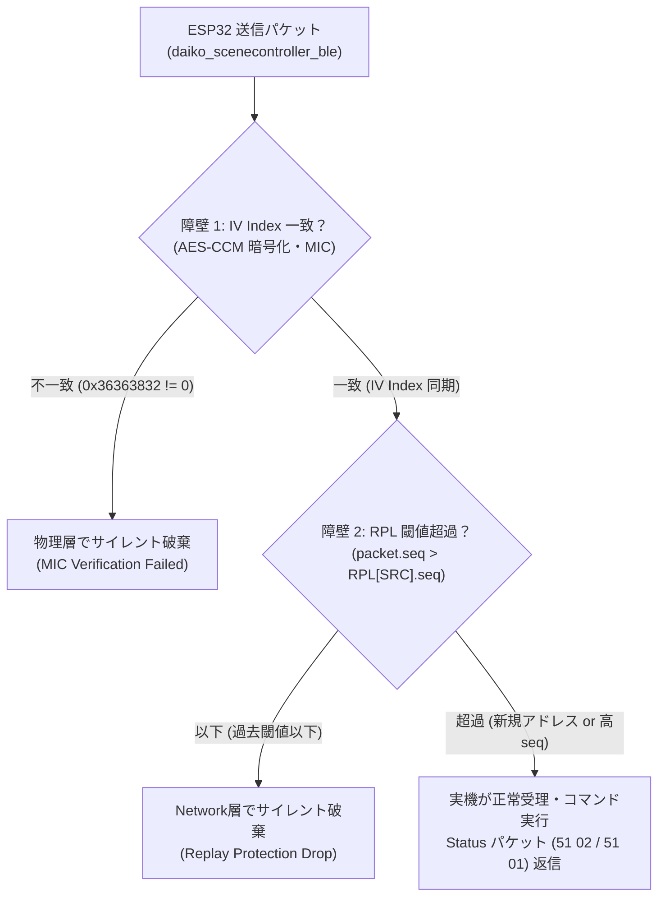
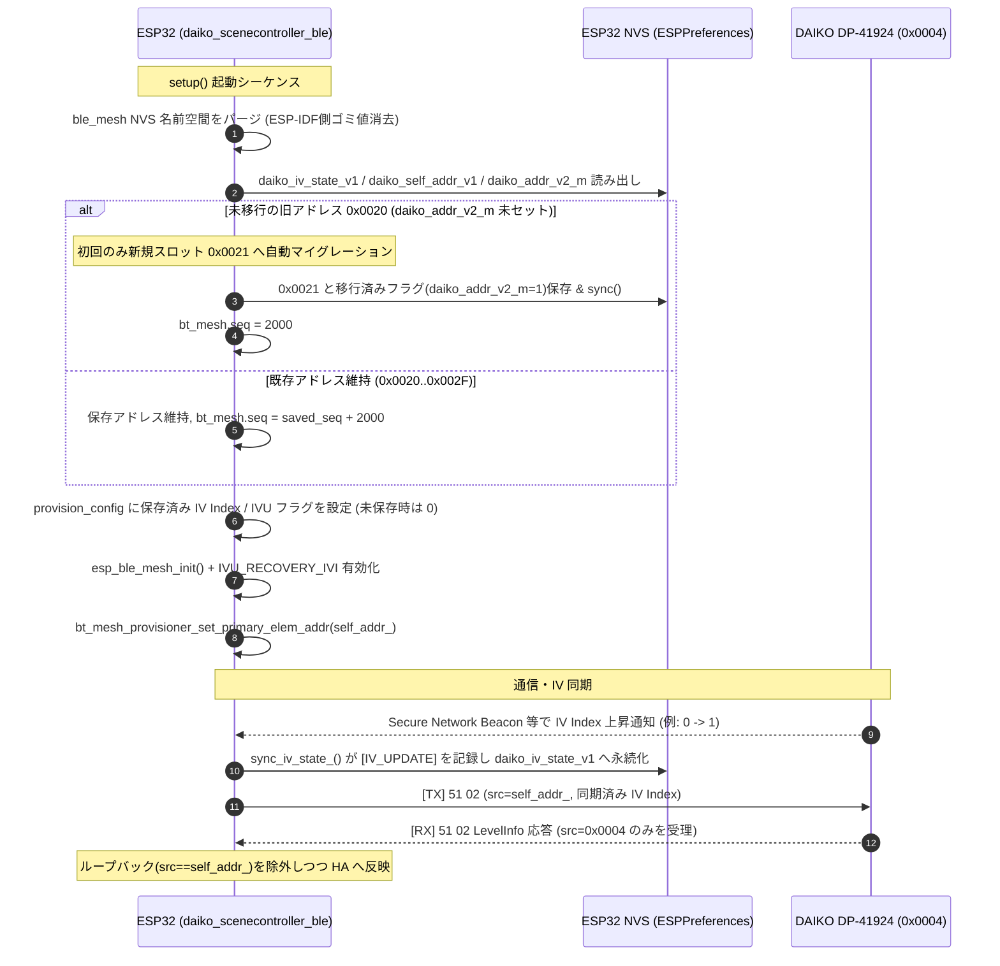
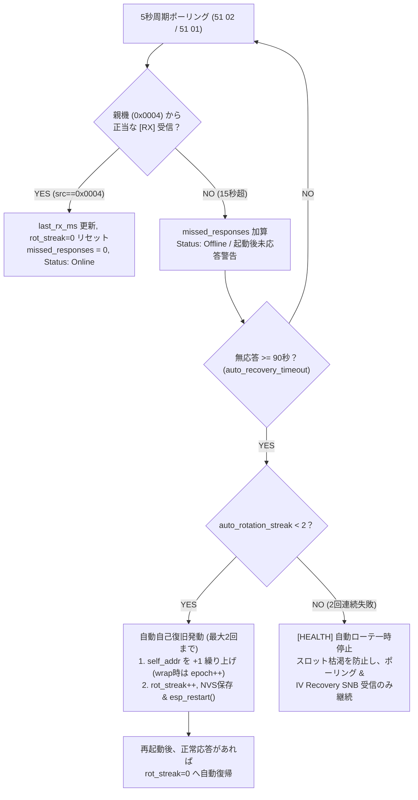

# DAIKO DP-41924 BLE Mesh 通信トラブルシューティングと保守改修ガイド

本ドキュメントは、大光電機（DAIKO）製 6回路シーンコントローラー（`DP-41924`）と ESP32（ESPHome `daiko_scenecontroller_ble`）間の通信において発生した **「実機完全沈黙（コマンド無応答・状態未受信）」インシデントの根本原因、Bluetooth Mesh 通信スタックの挙動特性、恒久設計、および今後の改修作業で同じ過ちを繰り返さないための保守ガイドライン** をまとめたものです。

> [!IMPORTANT]
> **IV Index 追従設計への改訂**:
> 初期障害への暫定対処として導入されていた **`bt_mesh.iv_index = 0` 強制固定および `[IV_CORRECT]` ドリフト上書き** は、正規の IV Index 更新（`0 -> 1`）と衝突して通信不能を引き起こしたため廃止しました。現行設計では `CONFIG_BLE_MESH_IVU_RECOVERY_IVI: y` と独自 NVS（`daiko_iv_state_v1`）による **IV Index 追従・永続化** へ移行しています。

---

## 1. インシデントの背景と概要

ESP32 からのパケット送信ログ（`[TX]`）は正常（`ESP_OK`）に出力されているにもかかわらず、**実機（DP-41924）が一切操作に追従せず、実機側からの状態通知（`[RX]`）も完全に途絶** する事象が発生しました。

外見上は「Bluetooth 送信は成功しているのに機器が動かない」という状態となりますが、これは単一の不具合ではなく、**BLE Mesh の暗号化層（IV Index）、リプレイ保護層（RPL / SeqNum）、および NVS 永続化層の 3 つの要因が連鎖** して発生します。



---

## 2. 通信障害の発生メカニズムと根本原因

### 2.1 【第1の障壁】BLE Mesh IV Index 汚染と AES-CCM MIC 検証失敗

#### BLE Mesh 暗号化の仕様
Bluetooth Mesh 仕様（Mesh Profile Spec 3.8.2）において、Network PDU は Network Key による AES-CCM 暗号化が行われます。この暗号化 Nonce は以下の 13 バイトで構成されます：
- `Nonce Type` (1 byte)
- `CTL / TTL` (1 byte)
- `Sequence Number` (3 bytes, 24-bit)
- `Source Address (SRC)` (2 bytes, 16-bit)
- `Padding` (2 bytes)
- **`IV Index` (4 bytes, 32-bit)**

#### 発生した現象と原因
- 構造体初期化漏れ、またはスタック上の未初期化データにより、ESP-IDF の NVS 名前空間 `ble_mesh`（キー: `mesh/iv`）に **`0x36363832`（ASCII 文字列相当のゴミ値）** が誤って永続化されました。
- ESP-IDF 内部で incoming beacon を受信した際、ビーコンの IV Index（`0x00000000`）と内部 IV Index（`0x36363832`）が衝突し、以下のエラーが発生していました：
  ```log
  E (32109) BLE_MESH: IVIndex out of sync: 0x00000000 != 0x36363832
  ```
- **破棄のメカニズム**:
  ESP32 は `IV Index = 0x36363832` で Nonce を生成してパケットを暗号化・送信していました。しかし、実機 DP-41924 は正規の IV Index で動作しているため、受信側の AES-CCM 復号時に **MIC（Message Integrity Check）の不一致** が発生します。
  MIC 不一致のパケットは Bluetooth コントローラー（物理層/Link層）で **エラー応答を返すこともなくサイレント破棄** されます。

---

### 2.2 【第2の障壁】Replay Protection List (RPL) によるサイレントドロップ

#### BLE Mesh リプレイ保護の仕様
Bluetooth Mesh では、リプレイ攻撃を防ぐため、受信側ノード（DP-41924）は内部に **Replay Protection List (RPL)** を保持しています（Spec 3.4.6.4）。
- 各送信元アドレス（SRC）から受信したパケットの最大シーケンス番号（`RPL[SRC].seq`）を記憶します。
- 受信したパケットのシーケンス番号が **`packet.seq <= RPL[SRC].seq` である場合、ノードはパケットを即座に破棄** します（ACK やエラー通知も一切返しません）。

#### 発生した現象と数値計算
- 本コンポーネントは 5 秒ごとに 2 パケット（`LevelInfo: 51 02` と `CtrlInfo: 51 01`）を定期ポーリングします：
  $$\text{1日の送信数} = \frac{86,400\text{ 秒}}{5\text{ 秒}} \times 2 = 34,560\text{ パケット/日}$$
- 56 日間連続稼働した場合：
  $$56\text{ 日} \times 34,560 \approx 1,935,360\text{ パケット}$$
- さらに、ESP32 が再起動するたびに安全マージンが加算されます。過去の開発・テストでの再起動や操作を合算すると、**DP-41924 の RPL が記憶していた `0x0020` のシーケンス番号は 2,100,000 を超過** していました。
- そのため、実機の RPL 閾値より小さい固定ベースラインを設定すると、**実機側のリプレイ保護フィルターによって全パケットが無言で破棄** されます。

---

### 2.3 【第3の障壁】セルフアドレス NVS 復元処理の固定化バグ

#### 発生した現象
- RPL の枯渇（または上限到達）を回避するために、本来はセルフアドレスを `0x0020` から `0x0021` へ繰り上げる（Rotate）設計となっていました。
- しかし、改修途中の `setup()` 内で `this->self_addr_ = this->base_self_addr_;` と上書きされていた時期があり、再起動するたびに `0x0020` に巻き戻されるデッドロックが発生していました。

---

## 3. 実装された解決策とアーキテクチャ（恒久化改訂版）

以上の障壁および IV Index 更新インシデントを踏まえ、現行アーキテクチャは以下の通り設計されています。



### 3.1 NVS ゴミ値パージと IV Index 永続化・追従設計
- `setup()` 冒頭で `nvs_open("ble_mesh", NVS_READWRITE, &mesh_nvs_handle)` を開き、`nvs_erase_all()` で ESP-IDF の Mesh 内部領域（`0x36363832` 等のゴミ値リスク）を初期化する。
- **重要**: `iv_index = 0` に強制固定すると実機ネットワークの正規 IV Index 更新（`0 -> 1`）と衝突するため行ってはならない。
- 正当な IV Index / IVU 状態を ESPHome 独自 NVS（`daiko_iv_state_v1`, `PersistedIvState`, `magic = 0x44495631`）へ保存して再起動時に `provision_config` へ復元し、さらに `sdkconfig_options` で **`CONFIG_BLE_MESH_IVU_RECOVERY_IVI: y`** を有効化して Secure Network Beacon からの自動追従を許可している。
- `sync_iv_state_()` では `> MAX_VALID_IV_INDEX`（`0x00100000`）の異常値のみエラー隔離（`[IV_ERR]`）し、`(iv=0, ivu=1)` による `BLE_MESH_NET_IVI_TX` の `0 - 1 = 0xFFFFFFFF` アンダーフローも同時に防いでいる。

### 3.2 アドレススロットの初回マイグレーションと NVS 永続化
- 過去の RPL 蓄積で機能不全となった `0x0020` を **1 回限りのフラグ（`daiko_addr_v2_m`）付きで `0x0021` へ移行** する。これにより、16 スロット一周後の正規ラップ先としての `0x0020` 再利用を妨げない。
- `rtc_self_addr_` の読み出し・保存処理を正常化し、再起動後も `0x0020` 〜 `0x002F` のスロットを確実に保持する。

### 3.3 シーケンス番号（SeqNum）の適正管理
- スロット変更（マイグレーションまたは Rotate）時：DP-41924 側の RPL は空であるため、安全な初期値 **`2000`** からクリーンスタート。
- 同一スロットでの再起動時：NVS 保存値に `+ 2000` を加算して再開（再起動直前の未保存パケットとの衝突を完全防止）。
- パケット送出時：5 パケット送信ごとに NVS（`rtc_seq_`）へ自動保存。

---

## 4. 恒久対策（Permanent）と運用上の留意点（Watchlist）の区分

### 4.1 恒久対策として確立された部分 (Permanent Architecture)

| 項目 | 実装内容 | 恒久性・理由 |
| :--- | :--- | :--- |
| **IV Index 追従と汚染隔離** | `ble_mesh` NVS パージ + 独自 NVS (`daiko_iv_state_v1`) 保存 + `CONFIG_BLE_MESH_IVU_RECOVERY_IVI: y` + 範囲/アンダーフローガード (`sync_iv_state_`) | **恒久対策**。ESP-IDF NVS ゴミ値（`0x36363832` 等）の隔離と、正規 IV Update（`0 -> 1` 等）への自動追従・再起動跨ぎ維持を両立。 |
| **受信元検証・ループバック遮断** | `custom_model_callback()` での `[RX_LOCAL]` 分離および `parse_vendor_status_()` での `src == controller_addr_` 限定受理 | **恒久対策**。グループ送信の自アドレスエコーで誤 `ONLINE` / 誤ヘルス復旧を起こさない。 |
| **アドレス自動巡回機構** | `0x0020`〜`0x002F`（16スロット）の巡回ローテーション + 連続自動ローテ上限（`MAX_AUTO_ROTATION_STREAK = 2`） | **恒久対策**。RPL トラブル時の自動復帰と、IV 不一致・実機停電時における 16 スロット無制限消費暴走の防止を両立。 |
| **SeqNum NVS 永続化** | 5パケット毎の保存 & 再起動時 `+2000` マージン加算 & 周回エポック管理（`wrap_epoch_`） | **恒久対策**。電源断や再起動によるリプレイ保護違反およびラップアラウンド時の固定 `seq` 衝突を防止。 |
| **ハードウェア二重構造制御** | `51 35`（開閉 `0x80`）と `51 51`（調光）の分離・連動 | **恒久対策**。DP-41924 の消灯回路ロックアウト挙動を完全吸収。 |
| **主電源 OFF 排他制御** | 主電源 OFF からの単独点灯シーケンス（`Exclusive ON`） | **恒久対策**。他回路を誤点灯させずに指定回路のみを確実に通電点灯。 |

### 4.2 長期運用時の留意事項 (Watchlist)

1. **アドレススロットの「一周巡回（ラップアラウンド）」時の挙動とエポック管理**:
   - スロットは初回 `0x0021` $\to$ `0x0022` $\to \dots \to$ `0x002F` $\to$ `0x0020` $\to \dots$ へと巡回します。
   - 1 スロットあたりの上限は `SEQ_MAX_THRESHOLD = 15,000,000`（1500万パケット）。5 秒ポーリング（年間約 1260 万パケット）の場合、1 スロットは約 1.2 年間持ち、16 スロット全体では **約 19 年間** 稼働可能です。
   - 一周（ラップアラウンド）した場合は周回カウンタ `wrap_epoch_`（`daiko_wrap_epoch_v1`, 0〜3）を繰り上げ、`epoch * 4,000,000`（`0` のときは `2000`）から再開することで同スロットの過去 RPL との衝突を回避します（より高い IV Index での Normal Operation へ遷移した際は BLE Mesh 仕様通りシーケンス空間が刷新されるため `wrap_epoch_` を `0` へ戻します）。
2. **ポーリング周期の調整**:
   - `DP-41924` は Pull 型デバイスのため、既定で 5 秒間隔のポーリングを行っています。スロット消費速度をさらに抑えたい場合は YAML の `update_interval` を `10s`〜`15s` に調整可能です。

---

## 5. 停電時の挙動・自動障害復旧（Auto-Recovery）と保守監視エンティティ

### 5.1 住宅の停電（瞬停・計画停電・ブレーカー断）が発生した場合のメカニズム

1. **親機のプロビジョニング情報（Unicast: `0x0004`, NetKey, AppKey）**:
   - 本体内部の不揮発性 Flash メモリに格納されているため、**停電によってアドレスやキーが消去されることは通常ありません**。
2. **親機側の RPL（Replay Protection List）**:
   - **Case A（Flash保持）**: RPL が保持されていた場合、ESP32 も NVS から前回の `saved_seq + 2000` で復帰するため、正常に通信が継続します。
   - **Case B（停電でRPLがリセットされた場合）**: 親機の RPL が `0` にリセットされた場合でも、Bluetooth Mesh 仕様上 `packet.seq > RPL[SRC].seq`（例: $2000 > 0$）が成立するため、ESP32 側のシーケンス番号が高くても **確実に受理** されます。
   - **Case C（復電時の不整合・通信沈黙）**: 復電時の過渡電圧サージ等で親機の RPL 状態が不整合になって応答しなくなった場合は、後述の自動自己復旧（Auto-Recovery）が作動します。

### 5.2 通信途絶の自動検知（Health Check）と有界自動自己復旧（Auto-Recovery）



- **検知ロジック**:
  - 親機（`0x0004`）からの `0x51` パケット受信が `15秒` を超えて途絶えた場合（起動後から一度も受信がない `last_rx_ms_ == 0` 状態を含む）、`is_connected_ = false`（親機オフライン）と判定して `missed_responses_` を加算し、警告を出力します。
  - 自身の送信元アドレス（`self_addr_`）から返るグループ送信エコーや非親機ソースは [`custom_model_callback`](../components/daiko_scenecontroller_ble/daiko_scenecontroller_ble.cpp#L102-L127) / [`parse_vendor_status_`](../components/daiko_scenecontroller_ble/daiko_scenecontroller_ble.cpp#L1039-L1098) で除外されるため、偽の `RESTORED` 復帰は起きません。
- **有界な自動自己復旧（Bounded Auto-Recovery）**:
  - 無応答状態が `auto_recovery_timeout`（デフォルト `90秒`、YAML で変更可能）継続し、かつ連続失敗回数 `auto_rotation_streak_` が `MAX_AUTO_ROTATION_STREAK`（`2`）未満の場合のみ `rotate_self_address_(true)` を実行します。
  - 2回連続で自動ローテーションしても親機が応答しない場合は自動ローテーションを一時停止し、残余スロットを守りながらポーリングと Secure Network Beacon（SNB）待機を継続します。親機応答を 1 回でも受信した時点で `auto_rotation_streak_` は `0` にリセットされます。

---

### 5.3 標準化アラートタグと Syslog 連携

異常検知や予兆保全を容易にするため、ログメッセージの先頭に構造化タグを付与しています。ESPHome の `syslog` コンポーネント（`level: WARN`）と組み合わせることで、定期ポーリングログによる帯域圧迫を抑えつつ重要イベントのみを外部ログ基盤へ転送できます。

| アラートタグ | ログレベル | 発生条件 | 対処・運用アクション |
| :--- | :--- | :--- | :--- |
| **`[DAIKO_BOOT]`** | `WARN` | BLE Mesh 初期化完了時（`self`, `ctrl`, `group`, `iv`, `ivu`, `ivi_tx`, `rot_streak`, `epoch`） | 起動時の構成・IV Index 実態確認（Wi-Fi 確立前のため API/シリアルで参照） |
| **`[IV_BOOT]`** | `WARN` | NVS `daiko_iv_state_v1` に不正な `(iv=0, ivu=1)` 状態を検出し `iv=0` に初期化した時 | IV 永続状態の異常復旧確認 |
| **`[IV_UPDATE]`** | `WARN` | `bt_mesh.iv_index` または `IVU` フラグの変化を検知し NVS へ永続化した時 | 正規 IV Update 追従の確認（例: `iv 0 -> 1`） |
| **`[IV_ERR]`** | `ERROR` | `bt_mesh.iv_index > MAX_VALID_IV_INDEX` の破損値、または `(iv=0, ivu=1)` のアンダーフロー危険を検知・修正した時 | スタック異常・NVS 破損の監視 |
| **`[HEALTH]`** | `WARN` / `ERROR` | 親機無応答（15秒超・起動後未応答含む）、自動復旧発動、連続2回上限到達による一時停止、または通信復旧（`RESTORED`） | 電源・電波・IV 障害の検知。一時停止時は SNB / 電源を再確認 |
| **`[ADDR_ROTATE]`** | `WARN` | アドレススロット繰り上げ（例: `0x0021` $\to$ `0x0022`）実行時 | スロット推移・エポックの把握 |
| **`[ADDR_WRAP]`** | `WARN` | 16 スロットを一周し `base_self_addr_`（`0x0020`）へラップアラウンドした時 | `wrap_epoch_` 増加を確認。エポック上限時は親機電源再投入を推奨 |
| **`[SEQ_WARN]`** | `WARN` | 送信シーケンス番号が上限の **80% (1,200万)** または **90% (1,350万)** に達した時 | 予兆保全アラート。上限到達前の計画的なアドレス更新の把握 |
| **`[SEQ_MAX]`** | `ERROR` | シーケンス番号が上限（1,500万）に到達し、自動アドレス更新が発動した時 | 自動退避の確認 |
| **`[SEQ_RESET]`** | `WARN` | 手動ボタン等でシーケンス番号リセットが要求された時 | 手動メンテ履歴の記録 |
| **`[TX_ERR]`** | `ERROR` | BLE Mesh メッセージ送信 API（`send_msg`）が失敗した時 | BLE スタック・ハードウェア異常の検知 |
| **`[TX_FAIL]`** | `WARN` | 送信完了コールバックでエラーコードが返却された時 | パケット送信失敗の検知 |
| **`[TX_TIMEOUT]`** | `WARN` | ACK 要求パケットの応答タイムアウト | 実機応答遅延・パケットロスの検知 |
| **`[RX_ERR]`** / **`[RX_WARN]`** | `WARN` | 受信パケットのサイズ不足・不正ヘッダ | 通信ノイズ・プロトコル不一致の検知 |
| **`[NVS_ERR]`** | `ERROR` | NVS へのアドレス / シーケンス / IV 状態書き込み失敗 | フラッシュ寿命・NVS 領域異常の検知 |

---

## 6. 今後の改修作業における厳重チェックリスト

本コンポーネントのコードを改修・リファクタリングする際は、以下のチェックリストを **必ず確認** してください。

### コーディング時の禁止事項・必須事項

- [ ] **`bt_mesh.iv_index = 0` への強制固定・引き戻し厳禁**:
  - `bt_mesh.iv_index` を常に `0` へ戻すと、実機側で正規の IV Update（`0 -> 1` 等）が起きた瞬間に通信不能となる。破損値の除外は上限チェック（`> MAX_VALID_IV_INDEX`）のみにとどめ、正当な遷移は `daiko_iv_state_v1` へ永続化して維持すること。
- [ ] **`CONFIG_BLE_MESH_IVU_RECOVERY_IVI: y` の必須化と `iv=0, ivu=1` ガード**:
  - `sdkconfig_options` から `CONFIG_BLE_MESH_IVU_RECOVERY_IVI: y` を削除しないこと。また ESP-IDF の `BLE_MESH_NET_IVI_TX` 定義上のアンダーフロー（`0 - 1 = 0xFFFFFFFF`）を防ぐため、`(iv == 0 && ivu == 1)` の保護を削除しないこと。
- [ ] **`esp_ble_mesh_prov_t` 構造体の指定初期化子によるゼロクリアと復元**:
  - `esp_ble_mesh_prov_t`（特に const メンバを含む構造体）は必ず designated initializer で初期化し、`.iv_index` と `.flags` には NVS から読み出した妥当値（初回は `0`）を設定すること。
- [ ] **受信元アドレス検証の維持（ループバック遮断）**:
  - `custom_model_callback()` / `parse_vendor_status_()` において、`src == self_addr_`（グループ送信のローカルエコー）および `src != controller_addr_` による `last_rx_ms_` / `is_connected_` 更新を行わないこと。
- [ ] **自動アドレスローテーション上限と 1 回限り移行の維持**:
  - 連続自動ローテーション上限（`MAX_AUTO_ROTATION_STREAK = 2`）および `daiko_addr_v2_m`（初回レガシー `0x0020 -> 0x0021` 移行済みフラグ）を外さないこと。
- [ ] **セルフアドレス・シーケンス番号の固定値リセット禁止**:
  - `setup()` 内で `self_addr_` に固定値を上書きしたり、`bt_mesh.seq` を実機 RPL 未満の小さい値へ戻したりしないこと。
- [ ] **`DAIKO_OPCODE_SET_UNACK` (`0xE30AF8`) の Unacknowledged 送信維持**:
  - 制御コマンド（`51 34`, `51 35`, `51 51`, `02 08`）は `need_ack = false` を維持すること。

### 通信不通が発生した際の診断フロー

```text
【ステップ 1: Home Assistant エンティティ & ログ状態確認】
  1. Home Assistant エンティティまたは Syslog サーバーを確認:
     - [IV_UPDATE] / [IV_ERR] が出ているか？
     - [HEALTH] Auto-recovery paused ... (iv=..., ivi_tx=...) が出ていないか？
  2. esphome logs daiko_controller.yaml でシリアル / API ログを確認:
     - [DAIKO_BOOT] の self / iv / ivu / ivi_tx / rot_streak / epoch を確認
     - [TX] の iv / ivi_tx / seq と、0x0004 からの [RX]（[RX_LOCAL] は自己エコー）の有無を確認

【ステップ 2: 原因別の切り分け】
  A. [RX] from 0x0004 が無く、rot_streak=2/2 で自動ローテ一時停止中:
     -> DP-41924 本体の電源断、または IV Index 不一致（SNB 未受信）の可能性。
        数分待っても SNB で [IV_UPDATE] が進まない場合は、壁面コントローラーの操作または
        分電盤ブレーカー電源再投入後に「状態更新 (Sync)」/「アドレス更新 (Rotate Address)」を実行。
  B. [IV_ERR] や [NVS_ERR] が連続出力:
     -> NVS 状態不整合。設定と sdkconfig (CONFIG_BLE_MESH_IVU_RECOVERY_IVI: y) を確認。
  C. 一時的無応答や SeqNum 閾値問題のみ (iv 一致):
     -> Home Assistant から「アドレス更新 (Rotate Address)」を押下し、次スロットへ退避。
```
